# Phishing-Email-Investigation-with-threat-intel

# Objective
In this project I investigated a phishing email from a client and proved the email was a spoof from the header and fail authentication. I mapped the sending infrastructure and the look-alike domain and cleared a legitimate email as a false positive with evidence, then I used the mail message trace and sign-in logs to scope the campaign, identified who clicked and confirmed two compromised accounts from an anonymous foreign sign-in. Then I wrote the incident report and recommended a detection rule to catch it faster.

# Skills 
- Email header and authentication analysis (SPF/DKIM/DMARC)
- URL and infrastructure analysis
- IOC enrichment (VirusTotal, AbuseIPDB)
- KQL campaign scoping
- phishing triage Aand reporting
- MITRE ATT&CK mapping

# Steps  
The emails represent Payroll update action required messages that looks like it is from Cloudora HR and links to a portal asking them to confirm their payroll
details. One employee also forwarded a marketing newsletter in the same batch, unsure whether it is part of the attack.
Mail 1
 

Mail 2
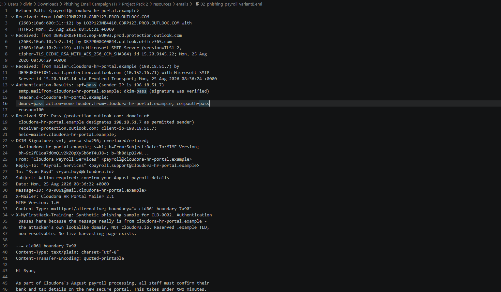 

Mail 3
 

Mail 4
 

Mail 5
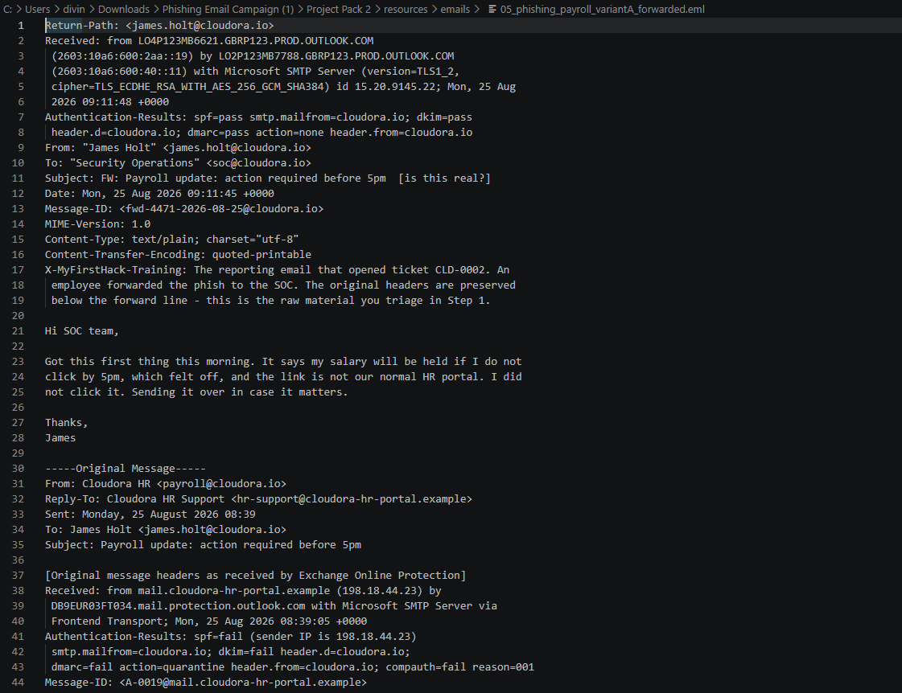 

Mail 6
 

The mail 5 started the ticket and was recieved by an employee. This raised the alarmsince he noticed it wasn't from the notmal HR address.

### Header analysis
Mail 1 has got a 'From header' showing the email was from payroll@cloudora.io, a 'Return-Path' payroll@cloudora.io where the notification goes to if mail not delivered and a 'Reply to' as hr-support@cloudora-hr-portal.example where normal replies goes to. This is show a potential red flag as the 'Reply to' header is different from the 'Return-path and the 'From' headers. SPF fail show the domain did not authorised the server for 
Mail 1 has got a 'From header' showing the email was from payroll@cloudora.io, a 'Return-Path' payroll@cloudora.io where the notification goes to if mail not delivered and a 'Reply to' as hr-support@cloudora-hr-portal.example where normal replies goes to. This is show a potential red flag as the 'Reply to' header is different from the 'Return-path and the 'From' headers. For the Authentication header, SPF fail show the domain did not authorised the server for payroll@cloudora.io to send emails using the cloudora.io domain name. DKIM authenticates teh origin of the email if it was sent from the sent domain but it fail for this. DMARC adds a layer of authentication between the SPF and the DKIM.This fails because the email failed the SPF and the DKIM checks.The recieved header give us the IPaddress of the sender which is '198.18.44.23'
Email one spoofs the domain cloudora.io and all three authentication failed and it actually came from alook-alike domain
Mail 2 is the second variant and Mail 6 is the first wave copy of the first variant.
The first variant A (mail 1) came from '198.18.44.23' and the second variant of the same variant (mail 6) came from '198.18.44.10' same style of email but different IP addresses this implise one attacker using two different laptops.Variant B mail 2 came from a different IP address '198.18.51.7' and this signifies an email campaign and contains two message template and 3 message servers and one look alike domain. The mail two passes the authentication checks (DKIM,SPF,DMARC) but this does not justify the email is legitiimate is shows the attacker had a legitimate domain registered
The mail 3 says the newsletter email and the authentication checks all passed maening the cloudora.io domain grants the servers to use it for emailing which is diifferent from the mail 2 authentication checks
Variant A (mail 1) spoofs the rael domain cloudora.io and fails everything and thats a phish. Variant B is a convincing looking email that passes its own domain so its also a phish, the newsletter passes contains real unsubscribe, real links and thats legitimate.

# Scope
This entails who clicked and who were those compromised during this attack. The screenshot below shows the delivered events, sender's ip, Dmarc,dkim and spf results, the delivery action. Some showed quarantine that means the failed authentication attempts were intercepted and labelled quarantine. The phish-B passesd all the authentication showing the filter trusted it.

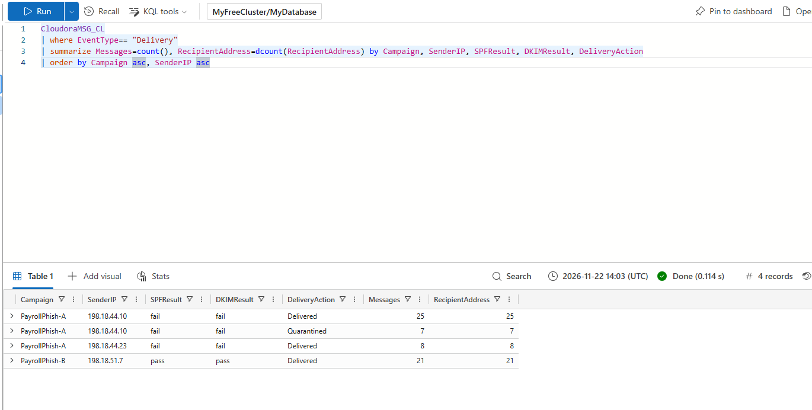

Looking at thosed that clicked the mail we see that six people clicked the mail and two people submitted their credentials

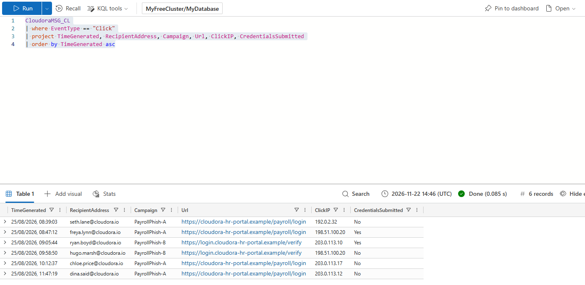 

Pulling the credential submitters logs we get 

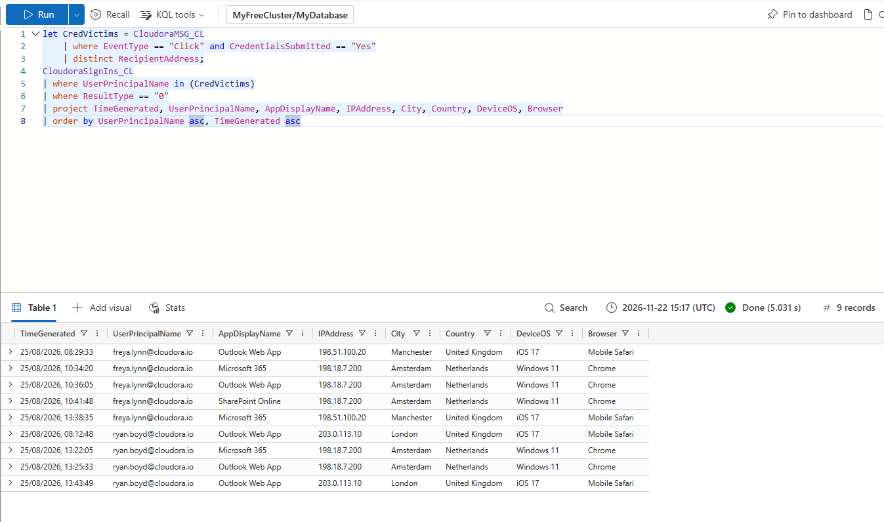 

Look at Freya Lynn. Her genuine sign-ins are from Manchester in the morning. Then at 10:34 there is a successful sign-in from 198.18.7.200, Amsterdam, on a Windows 11 / Chrome device she has never used about two hours after she submitted her password. That is the attacker logging in with the harvested credential (Valid Accounts, T1078). Impossible travel: Manchester then Amsterdam inside two hours. She is compromised. 

Using new indicator 198.18.7.200 to check for other victims:

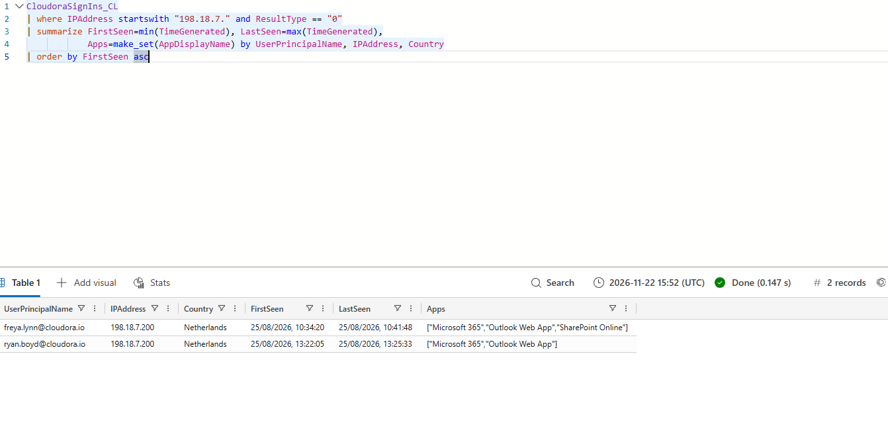 

Two compromised accounts, and one of them is not Freya. ryan.boyd@cloudora.io submitted credentials to variant B and was signed into from 198.18.7.200 at 13:22:05 UTC.

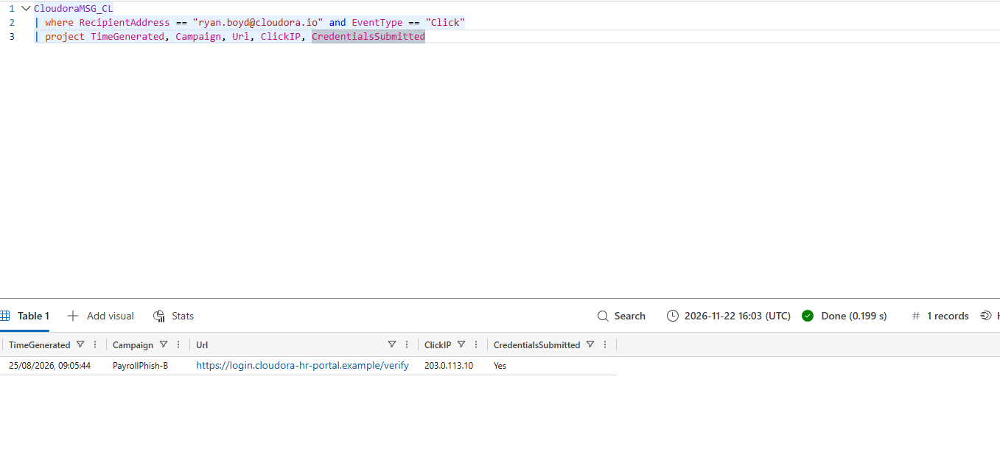 
One click at 09:05:44 on the variant B link (login.cloudora-hr-portal.example/verify) from his own London IP, CredentialsSubmitted = Yes. His password is compromised.

Buliding a time line for the account

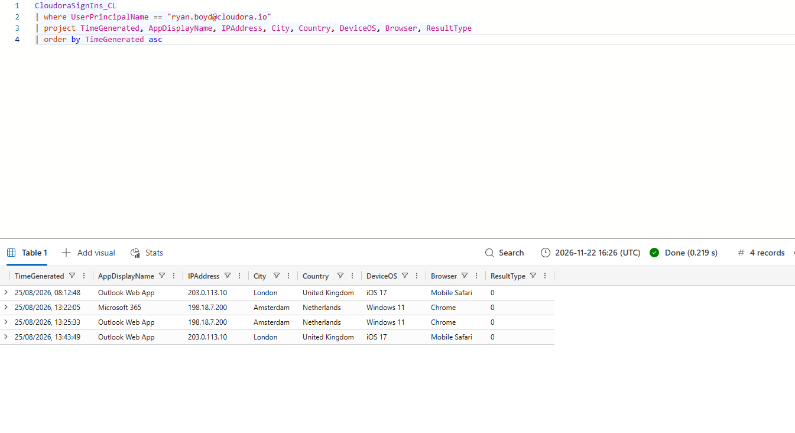 

Ryan works normally from London on his iPhone in the morning, submits credentials at 08:12, and at 13:22 the attacker signs in from Amsterdam on a Windows / Chrome device he never uses.Twenty-one minutes later Ryan is back on his own iPhone in London the account is in two countries eighteen minutes apart, which is impossible travel. That clean, first-try foreign success is the fingerprint of a credential-phishing compromise, versus the stack of failures you saw with a password spray

#### Baseline of accounts
London on his iOS device, plus the two Amsterdam / Windows rows. No travel pattern, no prior foreign activity. Same verdict as Freya compromised.

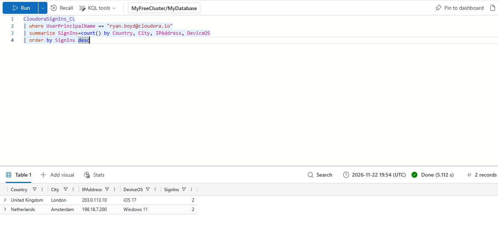 

#### Users that recieved the email
 This list entails everyone who received the phish but did not click.
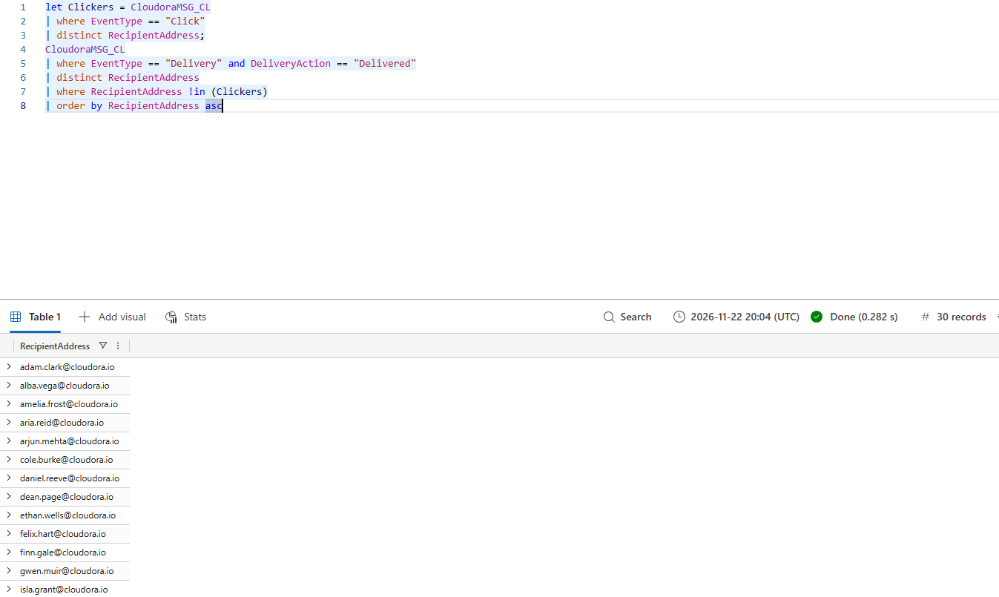 

the screenshot shows 30 accounts received a delivered phish and did not click. These get user communications and awareness. They include adam.clark@cloudora.io alba.vega@cloudora.io, isla.grant@cloudora.io, james.holt@cloudora.io, joel.kerr@cloudora.io
jude.ross@cloudora.io, kian.patel@cloudora.io, amelia.frost@cloudora.io,aria.reid@cloudora.io,arjun.mehta@cloudora.io, cole.burke@cloudora.io, daniel.reeve@cloudora.io, dean.page@cloudora.io, ethan.wells@cloudora.io, felix.hart@cloudora.io, finn.gale@cloudora.io, gwen.muir@cloudora.io, leah.stone@cloudora.io, lena.voss@cloudora.io, liam.doyle@cloudora.io, lucas.ford@cloudora.io, mira.shah@cloudora.io, noah.bishop@cloudora.io, olivia.kaur@cloudora.io, omar.farah@cloudora.io, priya.nair@cloudora.io, rhys.owen@cloudora.io, sofia.marino@cloudora.io, tara.kemp@cloudora.io, zara.aziz@cloudora.io, adam.clark@cloudora.io

Some of the reciepients recieved the mail and did not submit credentials

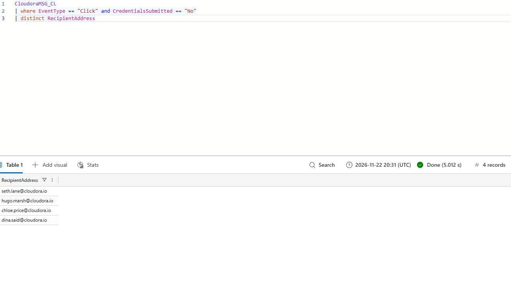 
They include: seth.lane, chloe.price, hugo.marsh, dina.said

#### Detection Rule to catch the attack before it occurs 

// Scheduled rule: phishing click followed by a foreign sign-in within 6h
let Clicks = CloudoraMsgTrace_CL
    | where EventType == "Click"
    | project ClickTime = TimeGenerated, UserPrincipalName = RecipientAddress,
              Url, ClickIP;
CloudoraSignIn_CL
| where ResultType == "0"
| join kind=inner Clicks on UserPrincipalName
| where TimeGenerated between (ClickTime .. (ClickTime + 6h))
| where IPAddress != ClickIP
| where Country !in ("United Kingdom", "United States")
| project UserPrincipalName, ClickTime, LoginTime = TimeGenerated,
          IPAddress, Country, DeviceOS, Browser, Url
| order by LoginTime asc

#### The model answer:
The 'Cloudora Monthly' newsletter is legitimate marketing mail - it passes SPF, is
DKIM-signed and aligned to the real cloudora.io via Mailchimp, passes DMARC, carries a one-click
unsubscribe, and links only to Cloudora's real list-manage domain. Variant B is a phish even though it also
passes SPF, DKIM and DMARC, because it passes for cloudora-hr-portal.example - the attacker's own
lookalike domain - not for cloudora.io, and passing authentication only proves the sending domain, not that
the sender is who they claim to be

# Incident Response

#### Executive summary
On August 25, 2026, a external attacker ran a payroll-themed phishing campaign aimed at 40 Cloudora staff. They pretended to be Cloudora HR and asked people to “confirm their payroll details” on a fake website. There were two approaches: one used a forged cloudora.io address that failed security checks, and another used a convincing lookalike domain that passed authentication for that fake site. Six employees clicked the link, and two entered their passwords. The attacker used those two passwords later that day from an Amsterdam address to sign in to the accounts. The incident was detected the same morning after staff reported the email. Both accounts were secured, the attacker’s access was cut off, the phishing campaign was blocked, and the fake messages were removed from mailboxes. A marketing newsletter reported by one employee was confirmed as legitimate. No fraudulent payments or data exfiltration were found in the logs. Four additional staff had clicked the link but did not enter passwords, and thirty more received the email but did not click. Those individuals are being contacted.

#### Incident Timeline

|Time (UTC) | source | Event |
|-----------|--------|-------|
| Aug 25, 06:58| Msg trace| Legitimate Cloudora newsletter delivered via Mailchimp (later reported, cleared as a false positive) |
| Aug 25, 08:04-08:20 | Msg trace| Phishing variant A, wave 1, sent from 198.18.44.10 spoofing payroll@cloudora.io; SPF/DKIM/DMARC fail; some copies quarantined by EOP, some delivered|
| Aug 25, 08:35-08:50 | Msg trace|  Variant A wave 2 from 198.18.44.23, and variant B from 198.18.51.7 using lookalike domain cloudora-hr-portal.example (auth passes for the fake domain) |
| Aug 25, 08:39:03 | Msg trace | seth.lane clicks the variant A link; no credentials submitted |
| Aug 25, 08:47:12 | Msg trace | freya.lynn clicks variant A and SUBMITS credentials |
| Aug 25, 09:05:44 | Msg trace | ryan.boyd clicks variant B and SUBMITS credentials |
| Aug 25, 09:11 | Ticket | james.holt forwards the phish to the SOC; ticket CLD-0002 raised, investigation starts |
| Aug 25, 09:58 / 10:12 / 11:47 | Msg trace | hugo.marsh, chloe.price and dina.said click the link; none submit credentials |
| Aug 25, 10:34:20 | Sign-in | Attacker signs in as freya.lynn from 198.18.7.200 (Amsterdam, NL) on Windows 11 / Chrome - harvested credential used (T1078); Outlook Web 10:36, SharePoint 10:41 |
| Aug 25, 13:22:05 | Sign-in | Attacker signs in as ryan.boyd from 198.18.7.200 (Amsterdam) - second account used; Outlook Web 13:25 |
| Aug 25, ~14:00 | Response | Containment executed on both accounts|

#### Findings

- On August 25, a phishing attempt targeted 40 Cloudora mailboxes with two subject lines: “Payroll update: action required before 5pm” and “Action required: confirm your August payroll details.” The messages pretended to be Cloudora HR and directed recipients to cloudora-hr-portal.example, a look-alike of cloudora.io. Exchange Online Protection quarantined all copies sent to 4 recipients, while 36 recipients had at least one copy delivered to their inbox. Evidence includes CloudoraMsgTrace_CL delivery events and the reported .eml files.
- Mail 1 spoofed the real address payroll@cloudora.io and failed SPF, DKIM, and DMARC (compauth=fail); it came from 198.18.44.10 and 198.18.44.23. Variant B originated from the attacker’s lookalike domain cloudora-hr-portal.example (198.18.51.7) and PASSED SPF, DKIM, and DMARC—but only for the lookalike domain, not for Cloudora. Authentication only proves the sending domain, not the message’s legitimacy; both variants are malicious. This is the same test that cleared the false positive in Finding 6.
- freya.lynn@cloudora.io and ryan.boyd@cloudora.io both clicked and submitted credentials (CloudoraMsgTrace_CL click events at 08:47 and 09:05, CredentialsSubmitted = Yes). Both were then signed into from 198.18.7.200 (Amsterdam, Netherlands) on a Windows 11 / Chrome device never seen on their accounts: Freya at 10:34 (impossible travel against her genuine Manchester sign-ins that morning), Ryan at 13:22. The attacker accessed Outlook Web and, for Freya, SharePoint Online. This is use of harvested valid credentials (T1078).
- seth.lane, chloe.price, hugo.marsh and dina.said clicked the phishing link (CredentialsSubmitted = No) and show no anomalous sign-in in the logs. They are not confirmed compromised, but a click means they reached the harvesting page; they are treated as elevated risk pending a precautionary password reset and a direct check-in.
- Thirty recipients received the email but did not click the link, making them near-miss cases who should receive awareness communications. Another four users (Emma Hayes, Maya Chen, Nina Cole and Ruth Dean) were targeted, but all copies of the email were quarantined by Exchange Online Protection before they could see them. Separating affected users into different categories ensures the response is appropriate and proportionate to their level of exposure.
- The 'Cloudora Monthly' newsletter forwarded by Adam Clark was legitimately distributed on Cloudora's behalf through Mailchimp. It successfully passes SPF, DKIM and DMARC checks, with its authentication properly aligned to the genuine cloudora.io domain. It also includes a valid one-click unsubscribe option and links only to Cloudora's official list-management domain. Unlike Variant B, its authentication confirms its association with the legitimate Cloudora brand.
Verdict: This is genuine marketing communication and is not associated with the attack. It has been cleared, with supporting evidence documented to prevent unnecessary future investigations.

#### Indicators of Compromise

| Type | Value | Context |
|------|-------|---------|
| Domain | cloudora-hr-portal.example | Lookalike of cloudora.io; phishing / credential harvesting; subdomains mail., mailer., login|
| URL | hxxps://cloudora-hr-portal[.]example/payroll/login | Variant A harvesting link (defanged) |
| URL | hxxps://login.cloudora-hr-portal[.]example/verify | Variant B harvesting link (defanged) |
| IPv4 | 198.18.44.10 | Variant A wave-1 sending relay + harvest host (Amsterdam, synthetic) |
| IPv4 | 198.18.44.10 | Variant A wave-1 sending relay + harvest host (Amsterdam, synthetic) |
| IPv4 | 198.18.51.7 | Variant B sending relay |
| IPv4 | 198.18.7.200 | Attacker sign-in IP (Amsterdam) - harvested credential use; blocked |
| Sender | payroll@cloudora.io (spoofed) | Forged From on variant A; Reply-To hr-support@cloudora-hr-portal.example |
| Sender |payroll@cloudora-hr-portal.example |Variant B From (lookalike domain) |
| Subject |Payroll update: action required before 5pm | Variant A |
| Subject |Action required: confirm your August payroll details | Variant B |

#### MITRE ATT&CK mapping

| Tactic | Technique ID | Technique name | Evidence |
|--------|--------------|----------------|----------|
|Initial Access | T1566.002 | Phishing: Spearphishing Link | Findings 1-2, the two phishing variants and their links |
| Credential Access| T1598.003 | Phishing for Information: Spearphishing Link | The credential-harvesting page behind the link |
| Initial Access | T1078.004 | Valid Accounts: Cloud Accounts | Finding 3, attacker sign-ins with harvested credentials |

#### Scope

- freya.lynn@cloudora.io (attacker sign-in 10:34:20 UTC) and ryan.boyd@cloudora.io (13:22:05 UTC), both 25 Aug, both from 198.18.7.200; both submitted credentials to the phishing page.
- Thirty received the phish and did not click (near-miss, user comms). Four more (emma.hayes, maya.chen, nina.cole, ruth.dean) had every copy quarantined by EOP. Full near-miss list is produced by the Task 2 query.
- seth.lane, chloe.price, hugo.marsh, dina.said - clicked the link, no credentials submitted, no anomalous sign-in. Precautionary reset and direct check-in.
- The 'Cloudora Monthly' Mailchimp newsletter - legitimate marketing mail

#### Actions Taken 

- Revoked all active sessions and refresh tokens for freya.lynn and ryan.boyd.
- Reset credentials for both compromised accounts
- Required and re-registered MFA on both accounts
- Blocked infrastructure: 198.18.44.10, 198.18.44.23, 198.18.51.7, 198.18.7.200 and cloudora-hr-portal.example (all subdomains) at mail gateway and web proxy.
- Delete  delivered phishing messages from all mailboxes.
- Verified: re-ran the victim sign-in and attacker-IP pivot queries; no 198.18.7.200 activity after containment.

#### Recommendation
-  Precautionary password resets and a direct check-in for the four clicked-but-no-credential staff; user communications and awareness for the thirty near-miss recipients.
-  Enforce MFA on all accounts and disable legacy authentication that bypasses it; both compromises were password-only.
-   Move cloudora.io DMARC policy to p=reject so spoofing variants like variant A are rejected outright, not merely quarantined, and downstream recipients reject them too.
-   Add mail-gateway detection for newly-registered lookalike domains and for external mail whose From is cloudora.io but which fails DMARC.
-   Deploy the sign-in detection from Task 4: a successful sign-in from a new country within a few hours of a phishing-link click. This would have flagged both compromises the same morning.
-    Block the phishing infrastructure permanently and monitor for the actor re-registering adjacent lookalike domains.

#### Lesson Learned
-  The first forwarded email opened the ticket before automated detection did, which argues for keeping the report button prominent and praised. The message trace turned a single reported email into full campaign scope in minutes, and pivoting on the attacker sign-in IP surfaced the second victim immediately. Never stop at victim one, the false positive mattered as much as the phish: variant B and the Mailchimp newsletter both pass authentication, and only checking which domain they pass for tells them apart. The gap to close is detection speed: both compromises were visible in the logs within an hour of the clicks, and a click-then-foreign-login rule would have alerted automatically rather than waiting on a human report.

