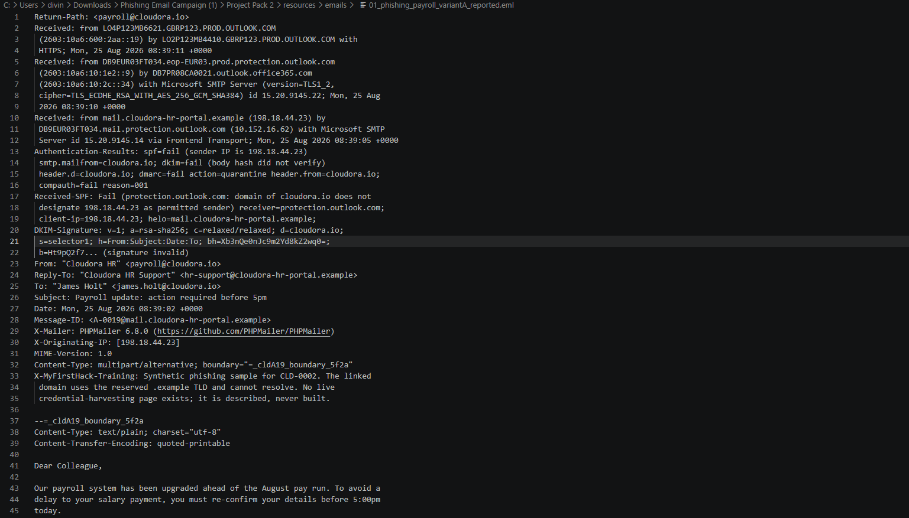
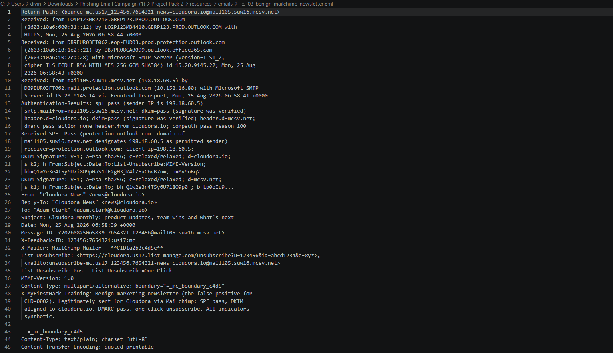

# Phishing-Email-Investigation-with-threat-intel

# Objective
In this project I investigated a phishing email from a client and proved the email was a spoof from the header and fail authentication. I mapped the sending infrastructure and the look-alike domain and cleared a legitimate email as a false positive with evidence, then I used the mail message trace and sign-in logs to scope the campaign, identified who clicked and confirmed two compromised accounts from an anonymus foreign sign-in. Then I wrote the incident report and recommended a detection rule to catch it faster.

# Skills 
- Email header and authentication analysis (SPF/DKIM/DMARC)
- URL and infrastructure analysis
- IOC enrichment (VirusTotal, AbuseIPDB)
- KQL campaign scoping
- phishing triage Aand reporting
- MITRE ATT&CK mapping

# Steps  
The emails represent Payroll update action required messages that looks like it is from Cloudora HR and links to a portal asking them to confirm their payroll
details. One employee also forwarded a marketing newsletter in the same batch, unsure whether it is part of the attack.
Mail 1
 

Mail 2
 

Mail 3
 

Mail 4
 

Mail 5
 

Mail 6
 

The mail 5 started the ticket and was recieved by an employee. This raised the alarmsince he noticed it wasn't from the notmal HR address.

### Header analysis
Mail 1 has got a 'From header' showing the email was from payroll@cloudora.io, a 'Return-Path' payroll@cloudora.io where the notification goes to if mail not delivered and a 'Reply to' as hr-support@cloudora-hr-portal.example where normal replies goes to. This is show a potential red flag as the 'Reply to' header is different from the 'Return-path and the 'From' headers. SPF fail show the domain did not authorised the server for 
Mail 1 has got a 'From header' showing the email was from payroll@cloudora.io, a 'Return-Path' payroll@cloudora.io where the notification goes to if mail not delivered and a 'Reply to' as hr-support@cloudora-hr-portal.example where normal replies goes to. This is show a potential red flag as the 'Reply to' header is different from the 'Return-path and the 'From' headers. For the Authentication header, SPF fail show the domain did not authorised the server for payroll@cloudora.io to send emails using the cloudora.io domain name. DKIM authenticates teh origin of the email if it was sent from the sent domain but it fail for this. DMARC adds a layer of authentication between the SPF and the DKIM.This fails because the email failed the SPF and the DKIM checks.The recieved header give us the IPaddress of the sender which is '198.18.44.23'
Email one spoofs the domain cloudora.io and all three authentication failed and it actually came from alook-alike domain
Mail 2 is the second variant and Mail 6 is the first wave copy of the first variant.
The first variant A (mail 1) came from '198.18.44.23' and the second variant of the same variant (mail 6) came from '198.18.44.10' same style of email but different IP addresses this implise one attacker using two different laptops.Variant B mail 2 came from a different IP address '198.18.51.7' and this signifies an email campaign and contains two message template and 3 message servers and one look alike domain. The mail two passes the authentication checks (DKIM,SPF,DMARC) but this does not justify the email is legitiimate is shows the attacker had a legitimate domain registered
The mail 3 says the newsletter email and the authentication checks all passed maening the cloudora.io domain grants the servers to use it for emailing which is diifferent from the mail 2 authentication checks
Variant A (mail 1) spoofs the rael domain cloudora.io and fails everything and thats a phish. Variant B is a convincing looking email that passes its own domain so its also a phish, the newsletter passes contains real unsubscribe, real links and thats legitimate.
