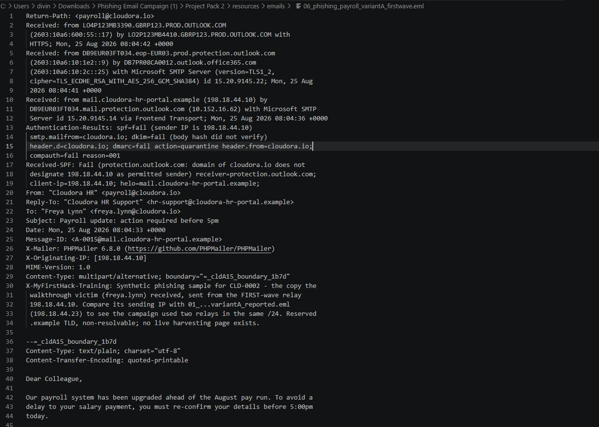

# Phishing-Email-Investigation-with-threat-intel

# Objective
In this project I investigated a phishing email from a client and proved the email was a spoof from the header and fail authentication. I mapped the sending infrastructure and the look-alike domain and cleared a legitimate email as a false positive with evidence, then I used the mail message trace and sign-in logs to scope the campaign, identified who clicked and confirmed two compromised accounts from an anonymus foreign sign-in. Then I wrote the incident report and recommended a detection rule to catch it faster.

# Skills 
- Email header and authentication analysis (SPF/DKIM/DMARC)
- URL and infrastructure analysis
- IOC enrichment (VirusTotal, AbuseIPDB)
- KQL campaign scoping
- phishing triage Aand reporting
- MITRE ATT&CK mapping

# Steps  
The emails represent Payroll update action required messages that looks like it is from Cloudora HR and links to a portal asking them to confirm their payroll
details. One employee also forwarded a marketing newsletter in the same batch, unsure whether it is part of the attack.
Mail 1
 

Mail 2
 

Mail 3
 

Mail 4
 

Mail 5
 

Mail 6
 
